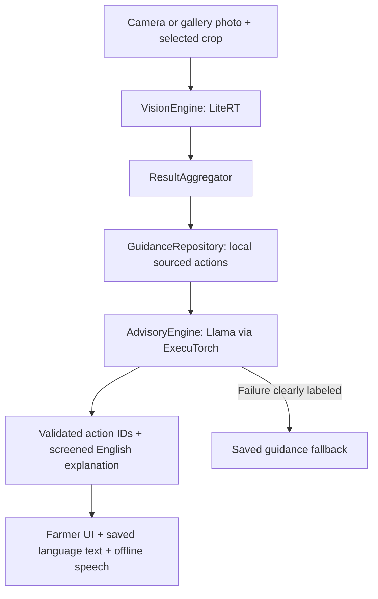

# Field Assistant

**An offline Android crop-health assistant for the Bharat AI–SoC Challenge 2026–27.**

**Built with Llama.** Current prototype: **v0.4.0**. Native Kotlin/Jetpack Compose;
real image inference with LiteRT and real Llama 3.2 inference with ExecuTorch.

[Install on a phone](docs/PHONE_SETUP.md) · [Build from source](docs/BUILD.md) ·
[Supported crops](docs/SUPPORTED_CROPS.md) · [Technical report](TECHNICAL_REPORT.md) ·
[Verification](docs/VERIFICATION.md) · [Model sources/licenses](THIRD_PARTY_NOTICES.md)

## The problem and our approach

Farmers need understandable next steps when a crop develops unfamiliar symptoms,
including in places with unreliable internet. A disease name alone is not enough:
they need to know what to check, which practical measures may help, and when to seek
an agricultural officer's assessment.

Field Assistant accepts a leaf photograph, runs a pretrained multiclass model on
the phone, and presents a cautious possible finding. An on-device Llama model uses
that finding and locally stored agricultural guidance to select useful next steps
and attempt a short English explanation. Farmers can read saved instructions in
English, Tamil or Telugu and listen using installed offline voices.

This is a **general, extensible crop assistant with limited current coverage**.
Sapodilla/mealybug is an intended future demonstration case, not the sole purpose;
**the current model does not support it**. No severity estimate or guaranteed cure
is claimed. Independent field accuracy is not established, and crop mismatches can
occur on real photographs.

## What works now

- Native Android camera/gallery flow and user crop selection/correction.
- Real 54-class leaf-image inference across 19 plants through LiteRT 1.4.2.
- Genuine Llama 3.2 1B Instruct SpinQuant INT4 execution through ExecuTorch 0.6.0
  on the ARM CPU, with automatic advice after photo analysis.
- Sourced care/treatment/prevention for potato early/late blight and narrower tomato
  early-blight guidance. Compact general reminders accompany these instructions.
- English/Tamil/Telugu UI and saved guidance; local speech with pause, resume,
  restart-from-beginning and stop. Voice data must be installed once on each phone.
- Explicit uncertain/unsupported/crop-conflict states and a clearly labeled saved
  guidance fallback if Llama is unavailable or fails.
- No backend, API key, app network permission, telemetry or cloud inference.

The sample-photo button and damage-status section have been removed. Numeric model
scores and technical diagnostics remain collapsed in the **debug** build; the release
build excludes that panel. Scores are not calibrated disease probabilities or severity.

## Run it on another phone

Do not assume every Android phone will work. Only the **Nothing A001, Android 16,
ARM64, approximately 8 GB RAM class and 4 KB memory pages** has been tested.

| Requirement | Current prototype |
| --- | --- |
| OS | Android 9 / API 28 or newer |
| Architecture | 64-bit ARM (`arm64-v8a`); no 32-bit-only Android or iPhone support |
| Memory pages | 4 KB; installer rejects other sizes pending native-runtime validation |
| RAM | Approximately 8 GB is the tested class; lower RAM/other vendors unverified |
| Phone storage | Allow about 3 GB free for APK, model, working space and voices |
| Setup connection | USB data cable, USB debugging and authorized computer |
| Speech | A phone TTS engine with installed **offline** English/Tamil/Telugu voices |
| Computer | Windows/macOS/Linux, Python 3.8+, Git (or downloaded source), adb |
| Internet | Needed for first-time tools/models/voice downloads; not for app inference |

Basic compatibility checks are not a guarantee that native inference will fit memory
or run successfully. macOS and the listed phone are tested; Windows/Linux setup code
is provided but has not been exercised on those operating systems.

### Quick installation — no Android Studio required

Read the [model licenses](THIRD_PARTY_NOTICES.md), then:

```sh
git clone https://github.com/potato285/FieldAssistant.git
cd FieldAssistant
python3 tools/setup_phone.py
```

On Windows use `py -3 tools/setup_phone.py`. First enable USB debugging, connect and
unlock **one** phone, and accept its authorization prompt. The script downloads the
published APK and the pinned Llama model/tokenizer, verifies SHA-256 checksums,
installs without clearing app data, provisions private model files, and opens the app.
Expect approximately **1.2 GB** of downloads. adb is downloaded from Google if absent.
Allow 4–5 GB free computer space for downloads/staging (more if building).

The repository contains source, metadata and download manifests. Large model weights
are fetched from their original pinned upstream sources; the installable APK is a
[GitHub Release asset](https://github.com/potato285/FieldAssistant/releases/tag/v0.4.0).
Installing only the APK does **not** install Llama. Follow the full
[phone setup, voice installation, update and troubleshooting procedure](docs/PHONE_SETUP.md).

## Build from source

Install JDK 17, Android SDK Platform 35, Build Tools 34.0.0 and Platform-Tools; configure
`JAVA_HOME` and `ANDROID_HOME`. The Gradle wrapper pins Gradle 8.9.

```sh
python3 tools/download_models.py vision
python3 tools/verify-assets.py
./gradlew assembleDebug testDebugUnitTest lintDebug
python3 tools/setup_phone.py --apk app/build/outputs/apk/debug/app-debug.apk
```

Windows: use `py -3` instead of `python3`, and `.\gradlew.bat` instead of `./gradlew`.
APK: `app/build/outputs/apk/debug/app-debug.apk`. Build stack: Kotlin 2.0.21,
AGP 8.7.3, Compose BOM 2024.10.01, compile/target SDK 35, min SDK 28.
See [complete build instructions](docs/BUILD.md), including device tests and signing.
A locally rebuilt debug APK may have a different signing key from the published APK.
Do not uninstall an existing installation without understanding that its model/data
will be deleted; see the update instructions.

## Supported crops and diseases

The classifier has **54 labels across 19 plants**. Coverage includes potato early/late
blight; multiple tomato conditions; apple scab/black rot/cedar rust; corn leaf diseases;
grape diseases; and additional plants listed below. A listed label is not an accuracy
claim. Some plants have **healthy-only** labels.

| Crop / plant | Conditions |
|---|---|
| Aloe | Anthracnose, Healthy, Leaf Spot, Rust, Sunburn |
| Apple | Scab, Black Rot, Cedar Apple Rust, Healthy |
| Bell Pepper | Bacterial Spot, Healthy |
| Blueberry | Healthy |
| Cactus | Dactylopius Opuntia (Cochineal), Healthy |
| Cherry | Healthy, Powdery Mildew |
| Corn (Maize) | Cercospora Leaf Spot (Gray Leaf Spot), Common Rust, Healthy, Northern Leaf Blight |
| Grape | Black Rot, Esca (Black Measles), Healthy, Leaf Blight (Isariopsis Leaf Spot) |
| Money Plant | Bacterial Wilt Disease, Healthy, Manganese Toxicity |
| Orange | Huanglongbing (Citrus Greening) |
| Peach | Bacterial Spot, Healthy |
| Potato | Early Blight, Healthy, Late Blight |
| Raspberry | Healthy |
| Snake Plant | Anthracnose, Healthy, Leaf Withering |
| Soybean | Healthy |
| Spider Plant | Fungal Leaf Spot, Healthy, Leaf Tip Necrosis |
| Squash | Powdery Mildew |
| Strawberry | Healthy, Leaf Scorch |
| Tomato | Bacterial Spot, Early Blight, Healthy, Late Blight, Leaf Mold, Septoria Leaf Spot, Spider Mites (Two-Spotted Spider Mite), Target Spot, Mosaic Virus, Yellow Leaf Curl Virus |

Detailed limitations and guidance coverage: [supported crops](docs/SUPPORTED_CROPS.md).
Crop-specific advice currently covers **tomato early blight and potato early/late
blight in Tamil Nadu, India**. Other findings get general observation/referral guidance.
A small number of pest-related labels do not make this a validated pest detector.

## Languages and speech

| Capability | English | Tamil | Telugu |
| --- | --- | --- | --- |
| Interface and saved guidance | Yes | Yes | Yes |
| Freely generated Llama explanation | Yes, if generation passes screening | No | No |
| Offline speech | With installed local voice | With installed local voice | With installed local voice |

Treatment/prevention instructions have saved language versions in
[`guidance.json`](app/src/main/assets/guidance.json). Llama selects/orders action IDs;
the app displays the selected language's stored text. **There is no runtime translation
model or translation API.** Android TextToSpeech reads the text; it does not translate.
Tamil/Telugu and agronomic review by qualified native speakers remain outstanding.
Language selection does not change the fixed Tamil Nadu guidance region.

## Exact Llama / ExecuTorch status

**Integrated and tested on a physical ARM Android phone; not a mock integration.**

1. Vision produces structured candidates. `ResultAggregator` checks selected-crop
   conflicts, unsupported crops and provisional score/margin thresholds.
2. `GuidanceRepository` retrieves eligible local actions for the finding and region.
3. `ExecuTorchAdvisoryEngine` loads the pinned Llama `.pte` and tokenizer from private
   app storage and asks it to select allowed action IDs. The output is parsed and
   validated; one corrective retry is allowed. It must include expert referral.
4. For a supported possible finding, a second native call attempts a short **English**
   explanation from selected nonchemical facts. Topic/format checks reject restricted
   treatment or certainty language; these checks **do not verify factual accuracy**.
5. The app displays saved action wording. All eligible cards remain accessible;
   Llama prioritizes them rather than inventing chemical instructions. Failed
   explanations are omitted with a message. Failed model selection uses explicitly
   labeled **Saved tips · AI advice unavailable**. This fallback is not Llama output.

The current model is **Llama 3.2 1B Instruct SpinQuant INT4 EO8**, exported by the
ExecuTorch community, pinned to `911221e0f49d3354cbd4697a9c09feee25cadec7`.
Runtime: **ExecuTorch Android 0.6.0**, CPU. No Hailo accelerator or remote inference.
Model and runtime are a tested pair; upgrading either requires renewed testing.
Private provisioning currently uses `adb run-as`, so it requires a **debuggable APK**.
A production model-import/distribution flow and release signing remain future work.

## How offline operation works

The APK contains the vision model, labels, guidance, translated UI text and native
runtimes. The setup script copies the approximately 1.14 GB Llama export and tokenizer
into private app storage. Android's speech engine stores downloaded offline voice
packs. After setup, photos, vision inference, Llama generation, saved text and speech
run locally. The app manifest requests **no INTERNET permission**.

An initial airplane-mode/no-active-network test passed vision, Llama and English/Tamil
speech synthesis. v0.4 phone tests passed without changing connectivity, using local
voices; no fresh airplane-mode result is claimed for that version. If the phone also
provides your computer's internet, keep its data/hotspot on during setup and tests.
Cloud-backed gallery photos may need to be downloaded first; choose locally stored
photos when demonstrating offline use.

## Architecture and our contribution



The replaceable interfaces are [`VisionEngine`](app/src/main/java/org/fieldassistant/vision/VisionEngine.kt),
[`ResultAggregator`](app/src/main/java/org/fieldassistant/core/Models.kt),
[`GuidanceRepository`](app/src/main/java/org/fieldassistant/advisory/GuidanceRepository.kt)
and [`AdvisoryEngine`](app/src/main/java/org/fieldassistant/advisory/AdvisoryEngine.kt).

Our work is the Android application, model integration/preprocessing, uncertainty
routing, local guidance and language presentation, advisory validation, speech controls,
setup tooling and device verification. **We did not train the vision or Llama model,
design SpinQuant, or create the original datasets.** Model training/export credit
belongs to their respective upstream authors.

## Verification and remaining work

- v0.4 debug/release compilation passed; 19 host tests passed; lint: 0 errors/9 warnings.
- Real potato content-URI photo → `potato_early_blight` → Llama advice passed;
  Llama took 22.876 seconds in the recorded final run. This uses a test photograph
  that may overlap training and is not an independent accuracy evaluation.
- English/Tamil/Telugu speech held position during pause, resumed, restarted and
  completed sentence sequences. Acoustic quality/pronunciation needs human review.
- The USB installer updated the existing test phone, verified its installed model
  and launched the app. Fresh provisioning on another phone remains untested.
- Camera/gallery launch/cancel and gallery callback paths were tested; actual camera
  shutter capture is not yet verified by the automated tests.

See [commands, measurements and limitations](docs/VERIFICATION.md). Outstanding work:
independent field evaluation and crop-mismatch improvement; reliable unknown detection;
sapodilla/mealybug support; validated severity; broader guidance; native-speaker and
agronomist review; more phones/16 KB pages; memory/thermal/battery evaluation; production
signing/provisioning; and the final narrated competition video.

## Model sources and licenses

| Component | Upstream credit | License/status |
| --- | --- | --- |
| Plantulus Doctor EfficientNetV2-B0 | [KumarjitC/plantulus-doctor](https://huggingface.co/KumarjitC/plantulus-doctor) | Publisher declares MIT; model card preserved; full training-data rights not independently audited |
| Llama 3.2 1B | [Meta Llama](https://huggingface.co/meta-llama/Llama-3.2-1B-Instruct) | Llama 3.2 Community License + acceptable-use policy |
| SpinQuant INT4 ExecuTorch export/tokenizer | [ExecuTorch community export](https://huggingface.co/executorch-community/Llama-3.2-1B-Instruct-SpinQuant_INT4_EO8-ET) | Llama 3.2 terms apply; pinned artifact hashes recorded |
| Test photographs | [PlantVillage / Mohanty, Hughes, Salathé](https://huggingface.co/datasets/mohanty/PlantVillage) | CC BY-SA 3.0 as declared by the dataset author's card; test-only, attributed |
| ExecuTorch / LiteRT | Meta/PyTorch / Google AI Edge | BSD-3-Clause / Apache-2.0 |

Full [third-party notices](THIRD_PARTY_NOTICES.md), [model download manifest](models/manifest.json),
[license files](app/src/main/assets/licenses) and [guidance sources](app/src/main/assets/guidance.json)
are included. No full dataset is redistributed. Agricultural guidance is sourced from
TNAU, UC IPM, PNW Extension and Manitoba Agriculture. Chemical options are saved,
conditional discussion points for a local officer/current product label, without
invented doses or schedules.

Llama 3.2 is licensed under the Llama 3.2 Community License, Copyright © Meta
Platforms, Inc. All Rights Reserved. **Built with Llama.**

This public repository is a competition source-code deliverable. A separate license
for the project's original application code has not yet been selected; third-party
materials retain their own terms. Public availability does not relicense model weights.
