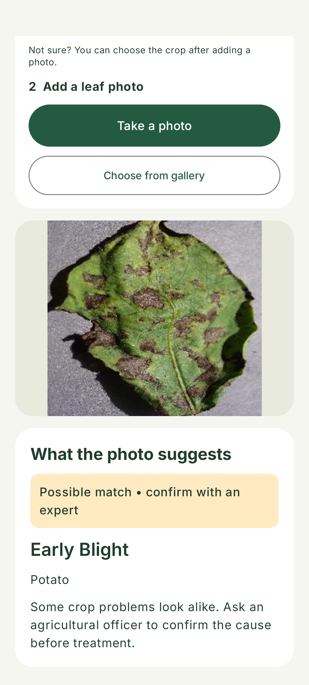
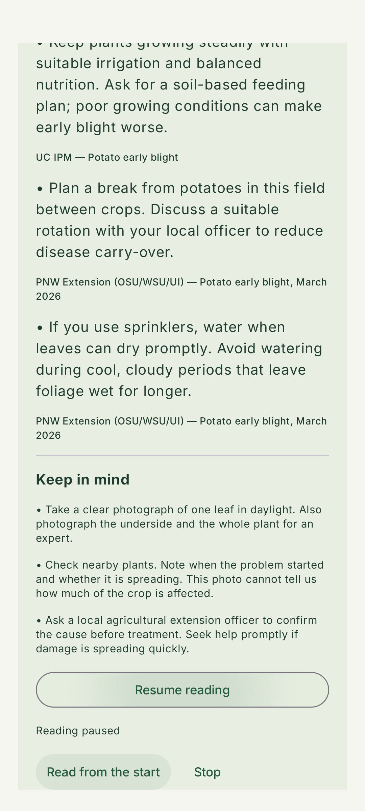

# Verification record

These records are from the physical **Nothing A001**, ARM64, Android 16/API 36,
4 KB pages, MemTotal 7,581,724 kB (approximately 8 GB RAM class), unless marked host.
A reproduced result is evidence of execution, not a field-accuracy claim.

## v0.4.0 final build and tests

```sh
bash tools/build.sh assembleDebug assembleDebugAndroidTest testDebugUnitTest lintDebug assembleRelease
bash tools/run-phone-test.sh org.fieldassistant.SpeechPlaybackTest,org.fieldassistant.GalleryAdvisoryFlowTest
# After removal of the damage-status UI:
bash tools/run-phone-test.sh org.fieldassistant.GalleryAdvisoryFlowTest
```

- Host: debug and unsigned release build successful, 19 unit tests, lint 0 errors/9 warnings.
- First phone run: 2 tests passed in 49.198 s. Final gallery regression: 1 test, 30.432 s.
- Actual potato photograph through content URI: early-blight candidate, score 0.87629944.
- Native Llama selection/explanation: 22.876 s final run, fallback false.
- English/Tamil/Telugu speech: position held while paused, resumed, restarted and
  completed sentence sequencing. Pause during preparation and cancellation also tested.
- Sample asset/button and damage-status section absent from farmer app; debug details
  collapsed; three-language UI and speech buttons checked.

[Build log](verification/v4/build-final.log) · [unit results](verification/v4/unit-tests.json) ·
[lint](verification/v4/lint.txt) · [phone log](verification/v4/phone-tests.log) ·
[final UI log](verification/v4/gallery-final.log) · [Llama raw output](verification/v4/potato-ui-v4.json) ·
[speech positions](verification/v4/speech-playback-v4.json).

The test photograph is PlantVillage and may overlap training. Tests exercise the
real gallery callback with a real content URI; system picker taps are not automated.
Camera/gallery launch/cancel was tested earlier; actual camera shutter capture remains
unverified. There is no human pronunciation or farmer usability evaluation yet.





PlantVillage photo attribution/license: [third-party notices](../THIRD_PARTY_NOTICES.md).
These are screenshots of the app only, not personal phone screens.

## Installation and offline status

```sh
python3 artifacts/FieldAssistant-Friend-Setup/install.py --adb tools/android-sdk/platform-tools/adb
```

The v0.4 installer verified APK/model hashes, updated the existing app while preserving
data, reused verified private model files and cold-launched in 706 ms.
[Installer output](verification/v4/friend-install.log). This is an update on a previously
provisioned phone, not an independently tested first-time transfer to another phone.
The repository setup wrapper adds downloads/staging around that installer; see the
[public-repository validation](PUBLICATION.md) for its separate checks.

The APK has [no INTERNET permission](verification/v4/apk-permissions.txt).
Original v0.1 airplane-mode/no-active-network tests passed real vision, Llama and
English/Tamil speech synthesis: [test log](verification/airplane-mode-test.log),
[vision result](verification/vision-phone-offline.json),
[Llama result](verification/llama-phone-offline.json).

**Current app — user-reported manual offline verification (22 November 2026):** the
project owner reports manually testing the app offline and confirms it works. This
observation is recorded separately from the automated test logs above. Speech uses
an external installed local TTS engine with downloaded offline voice data.

## What these tests do not establish

- Independent field accuracy, confusion matrix or per-class recall.
- Reliable unknown-image rejection or reliable automatic crop identification.
- Severity classification: required by the problem statement, not implemented in
  Phase 1, and explicitly planned for Phase 2. Sapodilla/mealybug detection is also absent.
- General accuracy of free Llama explanations or chemical registration/approval.
- Native-speaker/agronomist review, voice quality or real farmer usability.
- Other phones, lower RAM, 16 KB memory pages, battery or sustained thermal behavior.
- First-time installation on Windows/Linux or production release distribution.

Published evidence is copied from local logs with workstation paths and device serials
redacted. Timing values, model output and test outcomes are retained. Private development
logs, signing keys, SDK downloads, caches and personal project notes are excluded.
